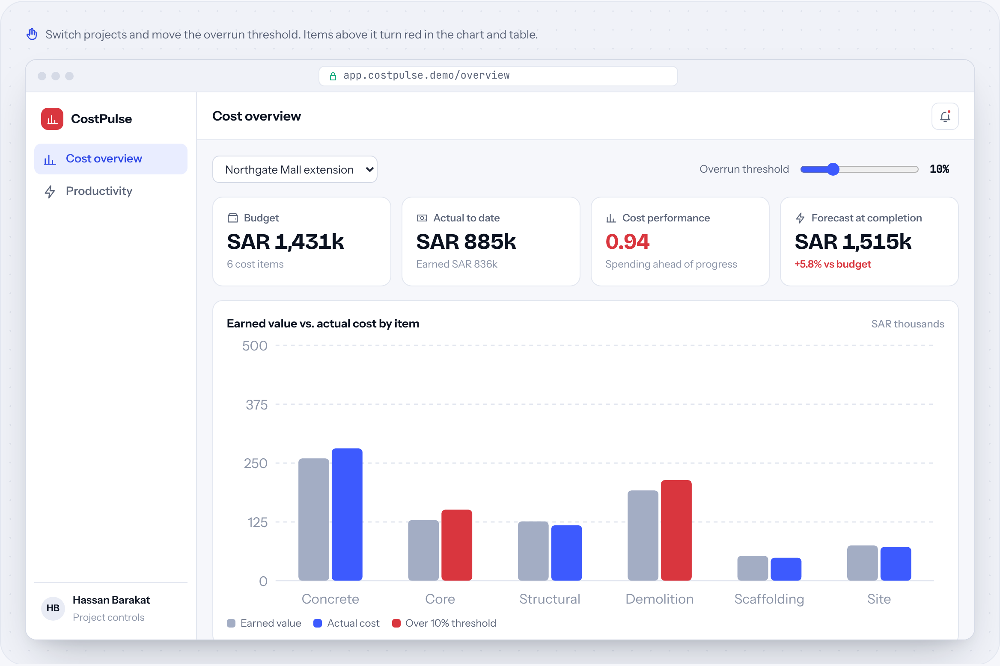
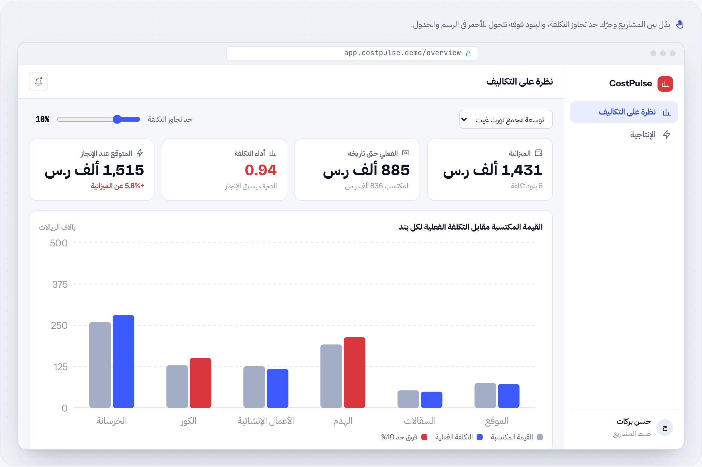

# CostPulse

**Cost & productivity dashboard** · Analytics & dashboards · by [HUDERA AI](https://www.linkedin.com/company/hudera)

Shows earned value against actual cost for every cost item while the work is still running, plus crew productivity against plan.

**[▶ Try the live demo](https://hudera-ai.github.io/costpulse/)** · runs in your browser on sample data · Arabic & English

## The problem
Overruns are usually discovered after an item is finished, when it is too late to act. Productivity data sits in daily sheets nobody compares with the plan.

## What it does
CostPulse combines budgets, progress and actual costs into earned-value figures per item, flags anything above your threshold, and charts each crew's daily output against the planned rate.

## Business value
Project managers see which items are drifting this week and which crews are behind, while there is still time to correct.

## Features
| Feature | Details |
| --- | --- |
| Earned value | Per item and per project |
| Threshold alerts | You choose the tolerance |
| Crew productivity | Daily output vs plan |
| Forecast | Estimate at completion |
| Multi-project | Switch projects instantly |
| Weekly PDF | For management meetings |

## How the workflow runs
**Inputs**: Budget & progress → **Costs**: Actuals to date → **Compute**: Earned value → **Flag**: Over threshold → **Share**: Dashboard & PDF

## Typical stack
Supabase · React · Charting · PDF reports

## Run it locally
Open `index.html` in any modern browser. No build step, no server, no data leaves your machine.

---

## CostPulse بالعربي

**لوحة التكاليف والإنتاجية**

يعرض القيمة المكتسبة مقابل التكلفة الفعلية لكل بند أثناء سير العمل، مع إنتاجية الفرق مقابل الخطة.

### المشكلة
تجاوز التكلفة يُكتشف عادةً بعد انتهاء البند حين يفوت وقت التصرف، وبيانات الإنتاجية تبقى في جداول يومية لا يقارنها أحد بالخطة.

### ما الذي يفعله
يجمع CostPulse الميزانيات ونسب الإنجاز والتكاليف الفعلية في أرقام قيمة مكتسبة لكل بند، وينبّه على أي بند فوق الحد الذي تحدده، ويرسم إنتاج كل فريق يومياً مقابل المعدل المخطط.

### القيمة للأعمال
مدير المشروع يرى البنود التي تنحرف هذا الأسبوع والفرق المتأخرة، والوقت ما زال يسمح بالتصحيح.

### المزايا
| الميزة | التفاصيل |
| --- | --- |
| القيمة المكتسبة | لكل بند ولكل مشروع |
| تنبيهات الحد | أنت تحدد هامش السماح |
| إنتاجية الفرق | الإنتاج اليومي مقابل الخطة |
| التوقع | التكلفة المتوقعة عند الإنجاز |
| متعدد المشاريع | انتقل بين المشاريع فوراً |
| تقرير PDF أسبوعي | لاجتماعات الإدارة |

### كيف يسير العمل
**المدخلات**: الميزانية والإنجاز ← **التكاليف**: الفعلي حتى تاريخه ← **الحساب**: القيمة المكتسبة ← **التنبيه**: فوق الحد ← **المشاركة**: لوحة مؤشرات وPDF

---

## About HUDERA AI
HUDERA AI builds WhatsApp AI assistants, business dashboards, workflow automations and custom SaaS products for companies in Saudi Arabia and the Gulf.

- LinkedIn: [linkedin.com/company/hudera](https://www.linkedin.com/company/hudera)
- Email: hudera.ai@gmail.com
- WhatsApp: [+20 155 515 9139](https://wa.me/201555159139)

> This repository is a product demo. Company names, people and figures inside it are fictional sample data.

© 2026 HUDERA AI. All rights reserved.
